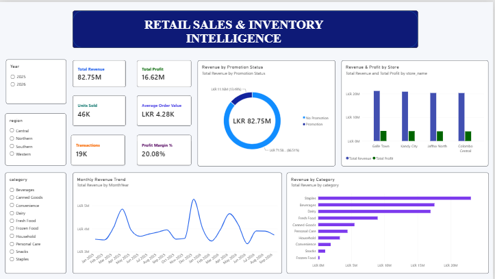
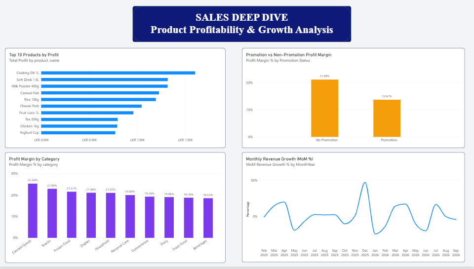
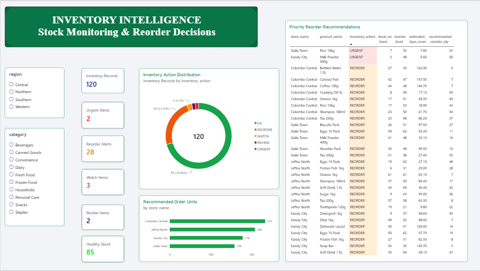
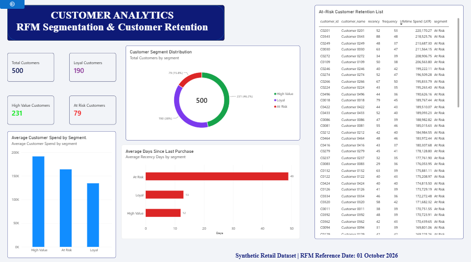
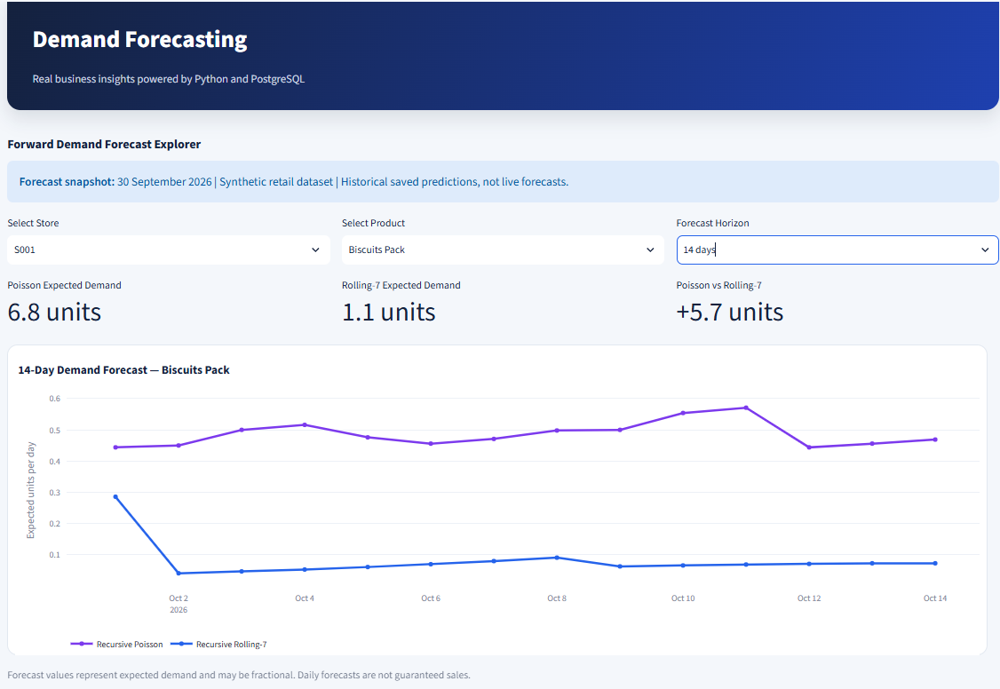
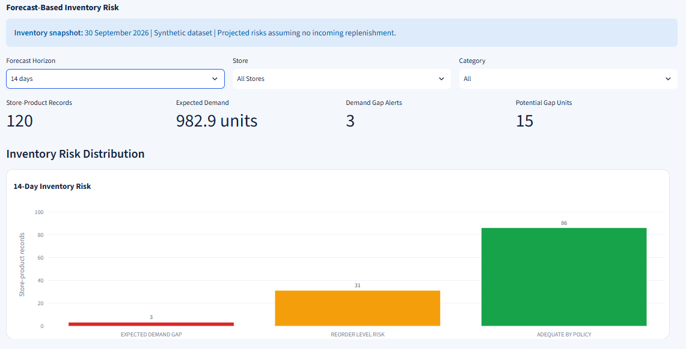
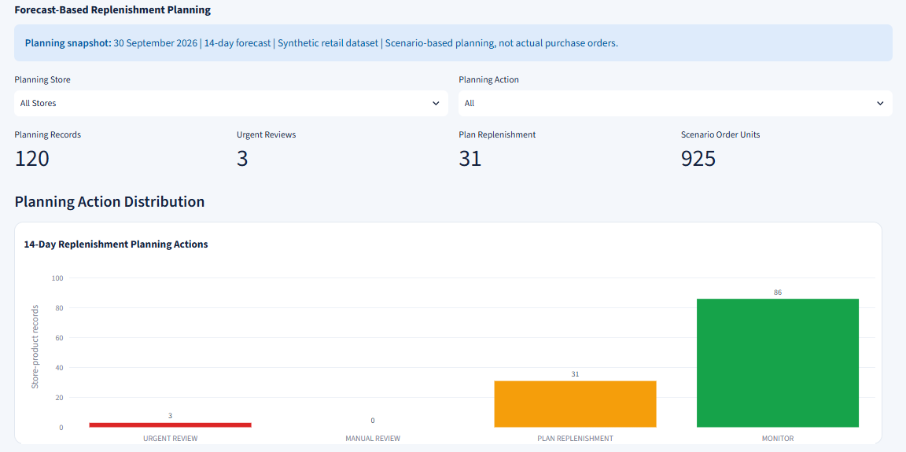
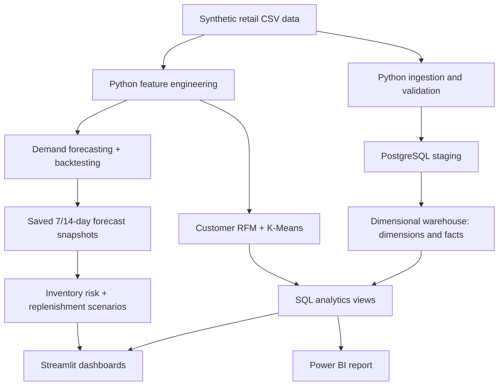

# Retail Sales & Inventory Intelligence Platform

**An end-to-end retail analytics and decision-support portfolio project** built with Python, PostgreSQL, machine learning, Streamlit, Power BI, and Docker.

[](https://github.com/balakrishnanpremnath/retail-intelligence-platform/actions/workflows/ci.yml)


[](LICENSE)

> [!IMPORTANT]
> **Synthetic-data portfolio project.** All retail transactions, customers, inventory figures, and business outcomes are simulated. Forecasts are **saved snapshots generated from data available through 30 September 2026**, covering **1–14 October 2026**. This is a **local demonstration**, not a live retailer, continuously updated prediction service, or automated purchasing system.

## Overview

Retail teams need a way to translate transactions and inventory records into decisions: **Which products drive profit? Which customers may need re-engagement? How much demand might occur? Which products could face stock shortages?**

This platform demonstrates a complete analytical workflow, from CSV inputs to a dimensional warehouse, customer segmentation, demand forecasting, inventory-risk assessment, and explainable stock-planning scenarios. It deliberately benchmarks sophisticated models against simple baselines rather than assuming machine learning is always better.

### What the platform delivers

| Component | Capability |
|---|---|
| **Executive Overview** | Revenue, profit, margin, sales trends, store and category comparisons |
| **Sales Analytics** | Product performance, category performance, and interactive sales exploration |
| **Customer Intelligence** | RFM features, K-Means segmentation, customer profiles and retention insights |
| **Demand Forecasting** | Historical model evaluation and interactive saved 7-/14-day recursive forecasts |
| **Inventory Intelligence** | Stock status, reorder rules, projected coverage gaps and forecast-based risk |
| **Replenishment Planning** | Transparent 14-day scenario quantities, planning actions and CSV export |
| **Power BI** | Separate interactive report built from the PostgreSQL analytics model |

## Dashboard previews

The screenshots below were captured from the local Streamlit application. Values shown are from the synthetic dataset.

| Executive overview | Sales analytics |
|---|---|
|  |  |
| Inventory intelligence | Customer intelligence |
|  |  |

### Recursive demand forecasting

Compare two methods across a selected store, product, and 7- or 14-day horizon. The forecast explorer displays expected units by day, cumulative expected demand, historical validation results, and downloadable predictions.



### Forecast-based inventory risk

Use the **30 September 2026** stock snapshot and saved Poisson forecasts to assess possible demand gaps, reorder-level risks, and stock coverage under a no-incoming-deliveries assumption.



### Explainable replenishment planning

Translate forecast demand and existing reorder thresholds into **illustrative planning quantities**, ranked by urgency. No orders are placed.



## System architecture



- **Data warehouse:** PostgreSQL star schema, staging tables, dimension and fact tables, and SQL reporting views.
- **Analytics:** Pandas feature engineering; SQL and Python business rules; customer segmentation.
- **Modeling:** Rolling-average and seasonal baselines, Poisson regression, Random Forest, and recursive forecasting.
- **Delivery:** Local Streamlit application with Plotly visualizations; Power BI `.pbix`; Docker Compose; automated tests and GitHub Actions.

## Dataset and business context

| Dataset / KPI | Verified value |
|---|---:|
| Retail transactions | **19,329** |
| Units sold | **46,418** |
| Distinct products | **30** |
| Store locations | **4** |
| Customers | **500** |
| Store-product inventory snapshot records | **120** |
| Sales date range | **1 Jan 2025 – 30 Sep 2026** |
| Revenue | **LKR 82,745,560.53** |
| Profit | **LKR 16,615,114.78** |
| Profit margin | **20.08%** |

The synthetic stores represent **Colombo, Kandy, Galle, and Jaffna**. Data sources are committed under [`data/raw/`](data/raw/), and the dataset fields are documented in [`docs/data_dictionary.md`](docs/data_dictionary.md).

The PostgreSQL warehouse contains **19,329 sales fact rows**, **120 inventory fact rows**, and matching product, customer, store, and date dimensions. The SQL assets are under [`database/sql/`](database/sql/).

## Machine learning and validation

### 1. Customer segmentation (RFM + K-Means)

Customers are summarized using **Recency, Frequency, and Monetary value**. After preprocessing and clustering, **3 clusters** were selected from the tested values (`k=2` to `k=6`), with a best tested silhouette score of **0.3674**.

| Descriptive segment | Customers |
|---|---:|
| High Value | 231 |
| Loyal | 190 |
| At Risk | 79 |
| **Total** | **500** |

These labels are business-oriented descriptions of **synthetic** customer behavior, not verified real-world customer outcomes. Methodology: [`docs/customer_segmentation.md`](docs/customer_segmentation.md).

### 2. Historical daily demand evaluation (one-step)

The **final 90 days (3 Jul – 30 Sep 2026)** were evaluated chronologically on **10,800 store-product-day observations**. This is a *one-step historical prediction* comparison, separate from the recursive multiday experiments.

| Forecasting method | MAE (units) ↓ | RMSE (units) ↓ |
|---|---:|---:|
| **Rolling 7-day average** | **0.8619** | 1.4525 |
| Poisson regression | 0.8829 | **1.3756** |
| Random Forest regression | 0.9197 | 1.3962 |

The **rolling 7-day baseline** achieved the lowest MAE, while **Poisson regression** achieved the lowest RMSE. Random Forest did **not** outperform the best simple baseline. This is an important result: model complexity alone did not provide better forecasting accuracy.

### 3. Recursive 7- and 14-day demand forecasting

For multiday horizons, predictions must be generated sequentially: after day 1, later lag and rolling-average features use **previous predictions**, not unknown future actual sales. The project implements this recursive process for Poisson regression and Rolling-7 and evaluates it on **three earlier rolling-origin folds**, before the final 90-day window.

| Method | Mean 7-day RMSE ↓ | Mean 14-day RMSE ↓ |
|---|---:|---:|
| **Recursive Poisson** | **1.3848** | **1.4468** |
| Recursive Rolling-7 | 1.4560 | 1.5123 |

Recursive Rolling-7 had the **lower MAE** of these two models, whereas recursive Poisson had the **lower RMSE**. A zero-forecast baseline achieved lower MAE in sparse demand data, but predicts no positive demand; this makes it unsuitable as the sole basis for stocking decisions. The application therefore shows **both Poisson and Rolling-7** results and does not claim one method is best on every metric.

**Evaluation integrity:** Data is split chronologically, forecasting features use historical information, and automated tests check that future actual values do not leak into recursive predictions. The multi-step validation folds and final 90-day one-step holdout are different evaluations; their metrics should not be presented as interchangeable.

See [`docs/model_evaluation.md`](docs/model_evaluation.md) and the results in [`models/`](models/).

## From predictions to decisions

### 14-day inventory-risk simulation

Saved **recursive Poisson forecasts** are joined to the matching **30 September 2026** inventory snapshot using store and product IDs. Assuming **no incoming stock**, the analysis estimates net stock after forecast demand, the rounded expected coverage gap, and whether remaining stock would fall below the recorded reorder level.

| Inventory-risk measure | 7-day horizon | 14-day horizon |
|---|---:|---:|
| Expected demand | 496.34 units | 982.85 units |
| Store-products with projected demand gaps | 1 | 3 |
| Total rounded potential gap | 1 unit | 15 units |
| Store-products at reorder-level risk (excluding gap category) | 32 | 31 |

Projected gaps are **not confirmed stockouts**; they depend on forecast estimates and the stated scenario assumptions.

### 14-day replenishment-planning policy

An explainable **illustrative rule** calculates a planning target and scenario quantity:

```text
planning_target_units = ceil(expected_14d_demand + reorder_level)
scenario_order_units = max(0, planning_target_units - stock_on_hand)
```

This treats the existing reorder level as an added **planning-policy buffer**. It is not an optimized economic order quantity or empirically calibrated safety-stock calculation. If forecast demand is zero and stock is below the reorder level, the system **flags manual review instead of proposing an automatic order**.

| Planning action | Store-product records |
|---|---:|
| Urgent Review | 3 |
| Plan Replenishment | 31 |
| Monitor | 86 |
| Manual Review | 0 |
| **Total** | **120** |

The policy proposes **925 scenario units** in total. **Do not confuse these with the 15 rounded units of potential 14-day demand shortage**: the larger number includes the replenishment buffer and is a hypothetical planning recommendation, not a confirmed purchasing requirement.

**Not modeled:** Supplier lead times, incoming shipments, minimum order quantities, prices and supplier constraints, service-level optimization, prediction intervals, and real-time stock updates. All purchasing decisions require human review.

## Technology stack

| Layer | Tools |
|---|---|
| Data processing | Python 3.12, Pandas, NumPy |
| Storage and warehouse | PostgreSQL 16, SQL, SQLAlchemy, psycopg2 |
| Analytics and ML | scikit-learn, RFM, K-Means, Poisson regression, Random Forest |
| Dashboards | Streamlit, Plotly, Power BI Desktop |
| Infrastructure | Docker, Docker Compose |
| Quality and CI | pytest, GitHub Actions |

## Repository structure

```text
retail-intelligence-platform/
├── app/                    Streamlit pages and dashboards
├── data/
│   ├── raw/                Versioned synthetic example CSVs
│   └── processed/          Generated analytical datasets (local)
├── database/sql/           Warehouse definitions, ETL SQL and views
├── dashboard/              Power BI Desktop report (.pbix)
├── docs/                   Business, modeling and data documentation
├── etl/                    Synthetic-data generation and feature engineering
├── images/                 Streamlit dashboard screenshots
├── models/                 Modeling code and selected output CSVs
├── scripts/
│   ├── bootstrap_database.py   Safe, fresh-database initialization
│   └── smoke_test.py          Docker/application health checks
├── tests/                  Automated data-quality and unit tests
├── .env.example            Local database environment template
├── .github/workflows/ci.yml
├── Dockerfile
├── docker-compose.yml
├── requirements.txt
└── README.md
```

## Getting started — Windows PowerShell

**Prerequisites:** Git, **Python 3.12**, Docker Desktop (with Docker Compose), and available local ports **5432** and **8501**. These instructions were tested with PostgreSQL 16 in a separate fresh database.

### 1. Clone and set local configuration

```powershell
git clone https://github.com/balakrishnanpremnath/retail-intelligence-platform.git
cd retail-intelligence-platform
Copy-Item .env.example .env
```

The `.env` file is **local and Git-ignored**. Its example values are for local development only. Change the credentials before any non-local deployment; never commit actual passwords. Host-side Python uses `POSTGRES_HOST=localhost`, while Compose configures Streamlit's internal database host as `postgres`.

### 2. Create the virtual environment

```powershell
py -3.12 -m venv .venv
.\.venv\Scripts\python.exe -m pip install -r requirements.txt
```

### 3. Start the database and perform the safety check

```powershell
docker compose up -d postgres
.\.venv\Scripts\python.exe scripts\bootstrap_database.py
```

The bootstrap script's **default mode is read-only**. If it reports **`No application schemas found`**, and you are intentionally setting up a **new, empty project database**, initialize it:

```powershell
.\.venv\Scripts\python.exe scripts\bootstrap_database.py --initialize
```

This loads the committed synthetic source data and saved analytics artifacts, creates the dimensional warehouse, and builds reporting views. **Do not use the initialization flag against an existing project database**. The script explicitly refuses to initialize if it detects any of the application schemas (`staging`, `warehouse`, `analytics`).

### 4. Start the dashboard

```powershell
docker compose up -d --build streamlit
docker compose ps
```

Open **http://localhost:8501** and explore the five workspaces. Forecasting and inventory-planning pages use **committed, saved model result files**; opening Streamlit does **not** retrain the models.

### 5. Run automated and end-to-end checks

```powershell
.\.venv\Scripts\python.exe -m pytest tests -q
.\.venv\Scripts\python.exe scripts\smoke_test.py
```

The **72-test** local suite passed at the documented checkpoint, and the GitHub Actions Python CI workflow runs the tests on pushes and pull requests to `main`. The smoke test verifies the Streamlit health endpoint and four nonempty PostgreSQL analytics views.

### Returning to an existing installation

When the project database is already populated, **skip `--initialize`**:

```powershell
docker compose up -d
docker compose ps
```

**Data safety:** The main PostgreSQL instance uses a persistent Docker volume. Do **not** run `docker compose down -v`, prune Docker volumes, or delete the project's named database volume if you need to keep that data.

## Reproducibility and limitations

- The versioned raw CSVs and selected modeling outputs make this **synthetic demonstration reproducible at the application/data-loading level**. The database bootstrap can restore its committed staging, warehouse and analytics data in a fresh database; it does not retrain every model.
- The fresh-bootstrap process was **tested in a separate PostgreSQL 16 sandbox**. Six counts matched the main instance: **19,329** sales facts, **120** inventory facts, **19,329** sales-view records, **120** inventory-view records, **500** customer-view records, and **21** monthly-view records.
- Model experiments use chronological data and stored artifacts. The dashboards do **not** ingest production transactions or current retail stock, retrain automatically, or deliver live forecasts.
- Synthetic transaction patterns and demand sparsity may not represent real-world retailers. Reported model accuracy and simulated savings or orders should **not** be generalized as real business impact.
- This is a locally runnable **portfolio prototype**, not a production-ready system with authentication, role-based access, monitoring, and live enterprise integrations.

## More documentation

- [Business insights](docs/business_insights.md)
- [Data dictionary](docs/data_dictionary.md)
- [Customer segmentation methodology](docs/customer_segmentation.md)
- [Inventory and reorder rules](docs/inventory_intelligence.md)
- [Demand forecasting evaluation](docs/model_evaluation.md)

Some detailed documents were written at earlier project milestones; the implemented scope described in this README reflects the current repository.

## Author and license

**Premnath** · [GitHub](https://github.com/balakrishnanpremnath)

Distributed under the [MIT License](LICENSE).
